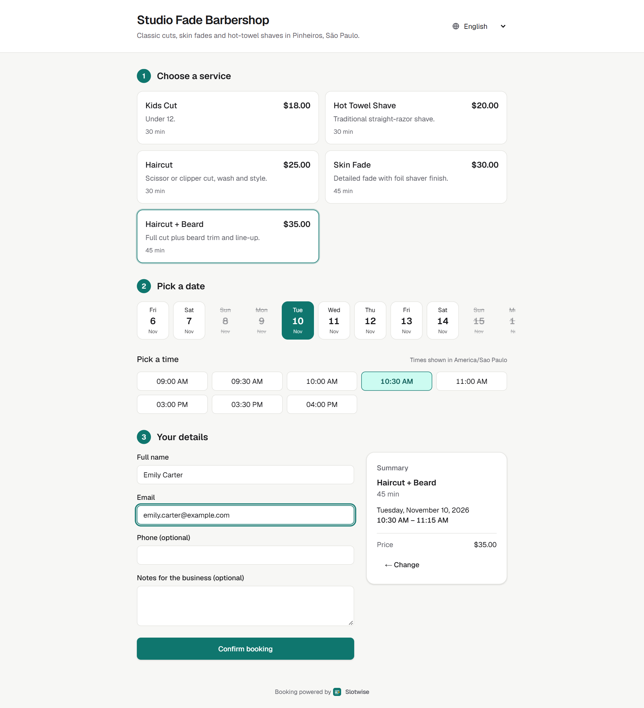
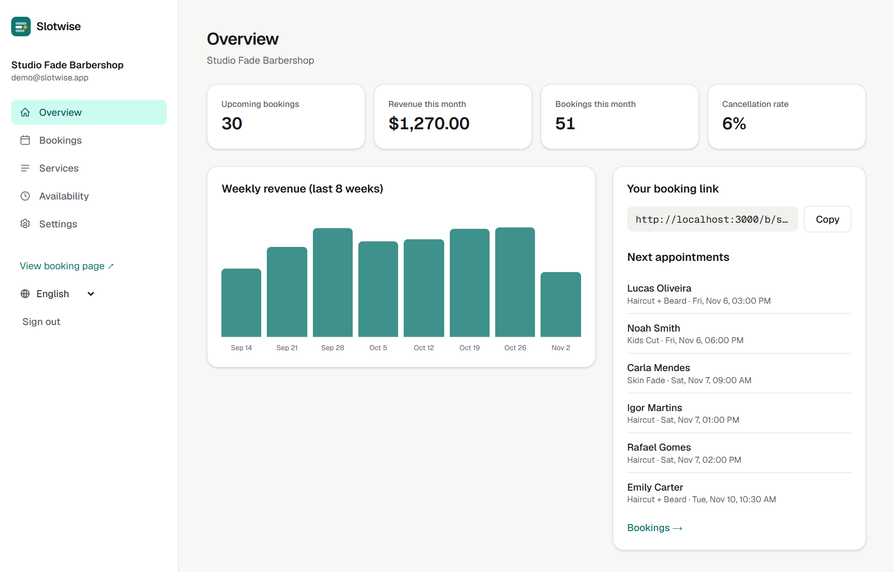
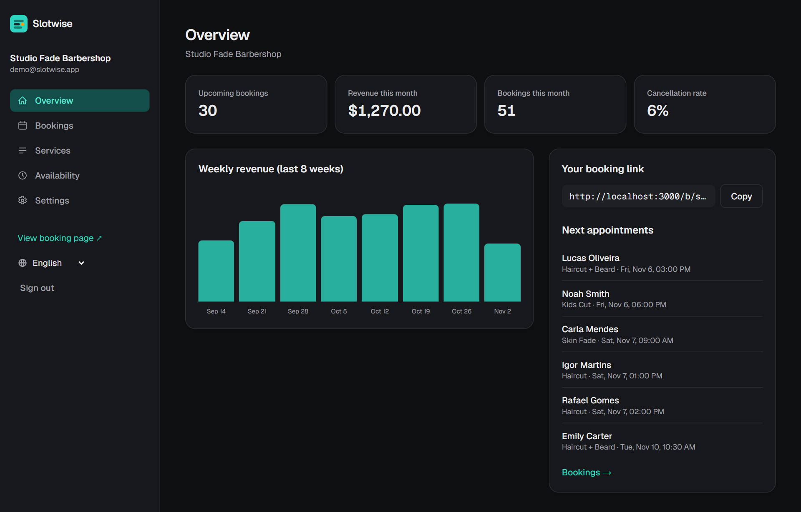
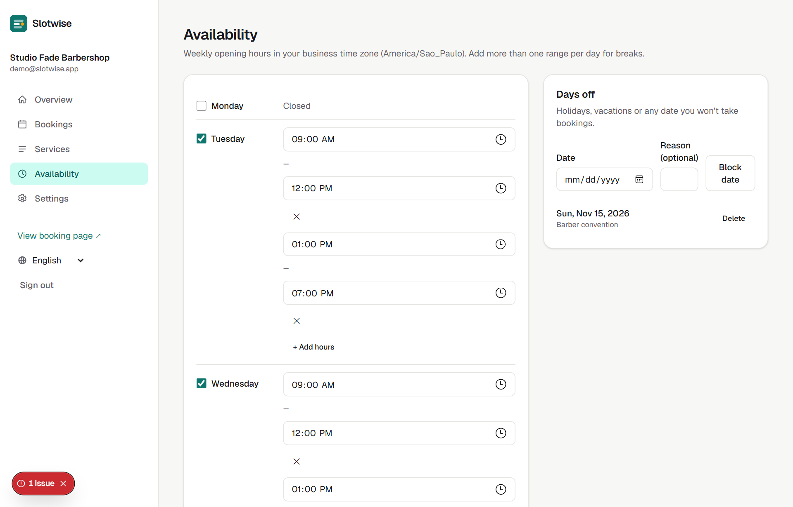
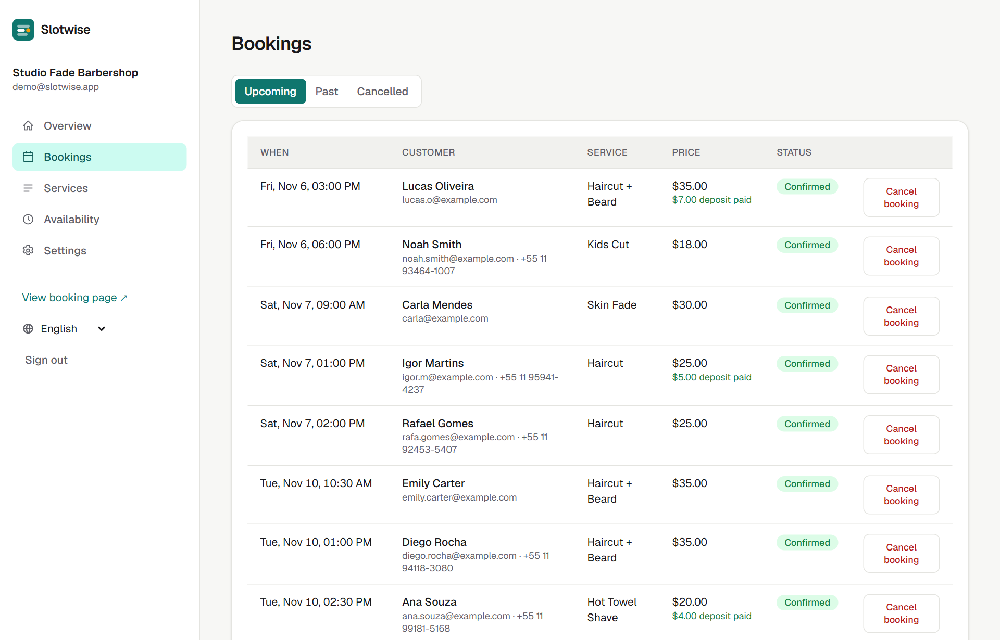
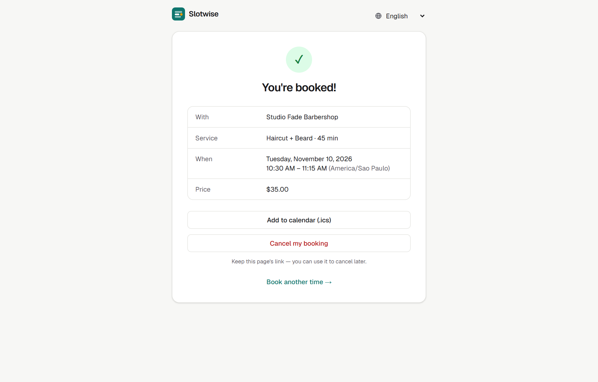
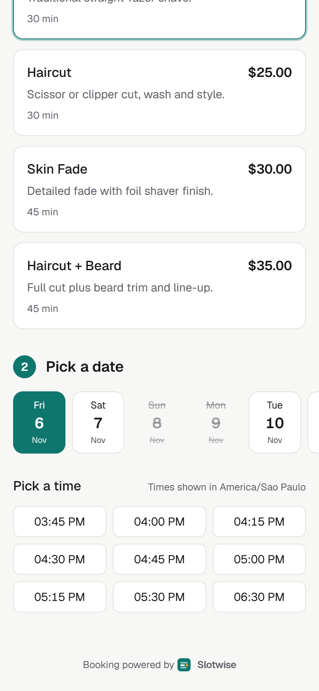

# Slotwise

Online booking for small businesses such as barbershops, clinics and personal trainers. Customers pick a service and a free time slot, the calendar never double-books, and the owner gets a dashboard with upcoming appointments and revenue.



A Portuguese version of this document is at the end.

## Features

- Business owner accounts with email and password or Google sign-in (Auth.js). New businesses start with default opening hours.
- Services with name, description, duration and price. A service that already has bookings is hidden instead of deleted, so history is kept.
- Weekly availability with several time ranges per day (for lunch breaks), plus blocked dates for holidays and vacations.
- Public booking page at `/b/[slug]`: a three-step flow (service, date and time, customer details) that works on phones and with a keyboard.
- Slot calculation based on opening hours, minus blocked dates, existing bookings, minimum notice and the booking horizon.
- No double booking. The chosen slot is checked again inside a `SERIALIZABLE` PostgreSQL transaction, so a race between two customers fails cleanly.
- Time zone handling. Opening hours are stored as local wall-clock time and bookings as UTC instants. Daylight saving gaps and overlaps are covered by tests.
- Confirmation page with a private link where the customer can view the booking, download an `.ics` calendar file or cancel.
- Optional deposit through Stripe Checkout (test mode only). The slot is held for 30 minutes and confirmed by webhook, or by checking the session when the customer returns.
- Dashboard with upcoming bookings, revenue for the month, cancellation rate and a weekly revenue chart computed in SQL.
- English and Portuguese across the whole app, including validation errors.
- Responsive and accessible: semantic landmarks, labelled form controls, `aria-invalid` errors, keyboard-friendly pickers, a skip link, visible focus and dark mode.

## Tech stack

Next.js 16 (App Router), React 19, TypeScript, Tailwind CSS 4, Prisma 7, PostgreSQL, Auth.js, Stripe, Zod, Vitest, ESLint, GitHub Actions.

## Architecture notes

```
src/
  lib/
    slots.ts         pure slot engine (no I/O), unit-tested
    time.ts          wall-clock and UTC conversion with DST detection
    validation.ts    Zod schemas and localized error messages
    stripe.ts        Stripe client that refuses live keys
  server/
    booking.ts       loads rules and bookings, serializable booking transaction
    stats.ts         dashboard figures and weekly revenue query
    actions/         Server Actions (auth, dashboard, public booking)
  app/
    b/[slug]/        public booking page
    booking/[token]/ customer page to view or cancel a booking
    dashboard/       owner area (overview, bookings, services, availability, settings)
    api/             slots JSON, Stripe webhook, .ics export, Auth.js
  i18n/              typed English and Portuguese dictionaries
prisma/              schema, migrations, demo seed
tests/               Vitest unit tests
```

1. The slot engine is a pure function. `getAvailableSlots()` receives rules, blocked dates, busy intervals and the current time as plain data and returns UTC instants. Since it never touches the database or the clock, the difficult cases (daylight saving, split shifts, back-to-back bookings, minimum notice) are covered by fast unit tests.
2. Two kinds of time. Opening hours mean "09:00 where the business is", so they are stored as minutes from local midnight together with an IANA time zone. Bookings are real moments and are stored in UTC. A local time that does not exist, such as the hour skipped when daylight saving starts, is left out instead of shifted.
3. The database prevents double booking. The server action does not trust the slot sent by the browser. It recomputes the free slots inside a `SERIALIZABLE` transaction, and PostgreSQL aborts one of two concurrent transactions (Prisma error `P2034`). That request is retried and then receives a "slot just taken" message.
4. Payment holds expire. A booking waiting for its deposit blocks the slot only until `holdExpiresAt`, so an abandoned checkout releases the time without a scheduled job.
5. Secrets stay out of the repository. Configuration lives in `.env` (see `.env.example`), and Stripe keys that are not test keys are rejected at runtime.

## Running locally

Requirements: Node.js 20.19 or later (24 recommended).

```bash
git clone https://github.com/fagundespenta/slotwise.git
cd slotwise
npm install
cp .env.example .env
```

1. Database. Any PostgreSQL works. For a local one with nothing to install, run `npx prisma dev` and copy the `postgres://` TCP URL it prints into `DATABASE_URL`. A free [Neon](https://neon.tech) database also works.
2. Secret. Set `AUTH_SECRET` in `.env`. You can generate one with `npx auth secret`.
3. Migrate, seed and start:

```bash
npx prisma migrate deploy
npm run db:seed
npm run dev
```

Open http://localhost:3000. The demo login is `demo@slotwise.app` with password `demo1234`, and the demo booking page is http://localhost:3000/b/studio-fade.

Google sign-in (optional): create OAuth credentials in Google Cloud with the redirect URI `http://localhost:3000/api/auth/callback/google`, then set `AUTH_GOOGLE_ID` and `AUTH_GOOGLE_SECRET`. The button appears only when both are set.

Stripe deposits (optional, test mode):

1. Put a test secret key (`sk_test_...`) in `STRIPE_SECRET_KEY`.
2. Forward webhooks with `stripe listen --forward-to localhost:3000/api/stripe/webhook` and copy the `whsec_...` value into `STRIPE_WEBHOOK_SECRET`.
3. Set a deposit percentage in Dashboard, Settings, then pay with the test card `4242 4242 4242 4242`.

| Script | Purpose |
| --- | --- |
| `npm run dev` | Start the development server |
| `npm run lint` | Run ESLint |
| `npm run typecheck` | Generate route types and run `tsc --noEmit` |
| `npm test` | Run the Vitest unit tests |
| `npm run build` | Production build |
| `npm run db:migrate` | Create or apply a migration in development |
| `npm run db:seed` | Reset and load the demo business |

## Tests

The slot engine and the validation schemas have unit tests in `tests/`, run with `npm test`. GitHub Actions runs lint, type checking, tests and a production build on every push.

## Deployment

The project deploys to Vercel with a Neon PostgreSQL database. `vercel.json` runs `prisma migrate deploy` before the build. The required environment variables are `DATABASE_URL` and `AUTH_SECRET`. `APP_URL` is optional on Vercel, where the production domain is used by default.

## Screenshots

| Dashboard | Dark mode |
| --- | --- |
|  |  |
| Availability | Bookings |
|  |  |
| Booking confirmed | Mobile |
|  |  |

## License

MIT. Copyright Pedro Henrique Siqueira Fagundes.

---

## Português

Agendamento online para pequenos negócios, como barbearias, clínicas e personal trainers. O cliente escolhe um serviço e um horário livre, a agenda nunca marca dois clientes no mesmo horário e o dono tem um painel com os próximos atendimentos e o faturamento.

### Funcionalidades

- Conta do negócio com e-mail e senha ou login com Google (Auth.js). Cada negócio novo começa com um horário de funcionamento padrão.
- Serviços com nome, descrição, duração e preço. Um serviço que já tem agendamentos é ocultado em vez de excluído, para manter o histórico.
- Disponibilidade semanal com vários intervalos por dia (para a pausa do almoço) e datas bloqueadas para feriados e férias.
- Página pública em `/b/[slug]`, com três passos (serviço, data e horário, dados do cliente), que funciona no celular e pelo teclado.
- Cálculo dos horários a partir do expediente, descontando datas bloqueadas, agendamentos existentes, antecedência mínima e o limite de dias à frente.
- Sem conflito de horários. O horário escolhido é conferido de novo dentro de uma transação `SERIALIZABLE` no PostgreSQL, então, se dois clientes tentam o mesmo horário ao mesmo tempo, só um consegue.
- Fuso horário. O expediente é salvo no horário local e os agendamentos em UTC. Os casos de horário de verão têm testes.
- Página de confirmação com link privado, onde o cliente pode ver o agendamento, baixar o arquivo `.ics` ou cancelar.
- Sinal opcional pelo Stripe Checkout (somente modo de teste). O horário fica reservado por 30 minutos e é confirmado pelo webhook ou quando o cliente volta ao site.
- Painel com próximos agendamentos, faturamento do mês, taxa de cancelamento e gráfico de faturamento semanal calculado em SQL.
- Português e inglês em todo o aplicativo, inclusive nas mensagens de validação.
- Responsivo e acessível: rótulos em todos os campos, erros com `aria-invalid`, navegação por teclado, link para pular ao conteúdo, foco visível e modo escuro.

### Tecnologias

Next.js 16 (App Router), React 19, TypeScript, Tailwind CSS 4, Prisma 7, PostgreSQL, Auth.js, Stripe, Zod, Vitest, ESLint, GitHub Actions.

### Notas de arquitetura

1. O motor de horários (`src/lib/slots.ts`) é uma função pura. Ele não acessa o banco nem o relógio, então os casos difíceis (horário de verão, pausas, agendamentos seguidos, antecedência mínima) são cobertos por testes unitários rápidos.
2. Dois tipos de tempo. O expediente ("abre às 09:00") é salvo em minutos desde a meia-noite local, junto com o fuso IANA. Os agendamentos são momentos reais e ficam em UTC. Um horário local que não existe, como a hora pulada no início do horário de verão, é descartado em vez de deslocado.
3. O banco impede o conflito. A action não confia no horário enviado pelo navegador: ela recalcula os horários livres dentro de uma transação `SERIALIZABLE` e tenta de novo quando o PostgreSQL detecta concorrência (erro `P2034` do Prisma).
4. Reservas aguardando pagamento expiram sozinhas (`holdExpiresAt`), sem tarefa agendada.
5. Nenhum segredo no repositório. A configuração fica no `.env` (veja o `.env.example`), e chaves do Stripe que não são de teste são recusadas.

### Como rodar

Requisitos: Node.js 20.19 ou mais recente (recomendado 24).

```bash
git clone https://github.com/fagundespenta/slotwise.git
cd slotwise
npm install
cp .env.example .env
npx prisma dev            # Postgres local: copie a URL postgres:// para DATABASE_URL
npx auth secret           # gera o AUTH_SECRET
npx prisma migrate deploy
npm run db:seed
npm run dev
```

Acesse http://localhost:3000. O login de demonstração é `demo@slotwise.app` com a senha `demo1234`, e a página de demonstração fica em `/b/studio-fade`.

Para o login com Google e o sinal com Stripe, siga as instruções opcionais da versão em inglês. Use o cartão de teste `4242 4242 4242 4242`.

### Testes

O motor de horários e os schemas de validação têm testes unitários em `tests/`, executados com `npm test`. O GitHub Actions roda lint, verificação de tipos, testes e build de produção a cada push.

### Deploy

O projeto é publicado na Vercel com banco PostgreSQL no Neon. O `vercel.json` roda `prisma migrate deploy` antes do build. As variáveis obrigatórias são `DATABASE_URL` e `AUTH_SECRET`. O `APP_URL` é opcional na Vercel, que usa o domínio de produção por padrão.

### Licença

MIT. Copyright Pedro Henrique Siqueira Fagundes.
